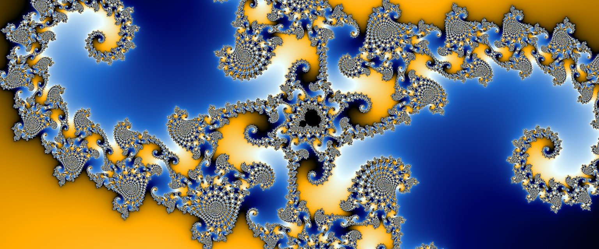

# fractalwright



An agent plugin that renders, explains and measures fractals. Every picture comes with a recipe file that redraws it pixel for pixel.

Ask an agent for "a Mandelbrot wallpaper" and you usually get a screenshot from somewhere, or code that renders once and is never the same again. fractalwright is a skill for AI coding agents plus one small script, `fw.py`. It renders in float64, writes a recipe JSON next to every PNG, and checks its own numbers against known values, so the agent can say how far to trust them.

The banner above is `fw.py render seahorse --palette ultra --size 1536x640`. Its recipe is [banner.recipe.json](.github/images/banner.recipe.json).

## What you get

- **Stills from recipes.** Mandelbrot, Julia, Burning Ship, Tricorn, Multibrot and Kronecker (grid) fractals, with smooth colouring, supersampling and palettes. A preset name or a recipe JSON goes in; a PNG and the recipe that redraws it come out.
- **Measurements with error bars.** Box-counting dimension with a verdict on the fit range, lacunarity, IFS similarity dimension from scale ratios, profile and heightmap roughness (Hurst exponent), Katz, and the area of the Mandelbrot set. Each is tested against a shape whose answer is known.
- **Plain explanations.** `fw.py explain <family>` prints the formula and how it is drawn, for a reader who has not met it before.
- **Sheets and video.** `fw.py sheet` lays variations of one parameter or palette out on a labelled contact sheet with each tile's recipe. `zoom`, `morph` and `loop` write exact frames, an H.264 mp4 and an animation recipe; `flashcheck` counts luminance swings per second against the three-per-second photosensitivity limit.
- **Audio visuals.** `fw.py audio song.wav` turns a song into a fractal video in sync with it: bass swells the shape and kicks the zoom, mids drift the colour, the key sets the hue. Frames are stepped, never captured live, and a flash limiter keeps big brightness swings to 3 a second or fewer. The explorer server also has a live page at `/audio` for a file or the microphone.
- **Explorer.** `fw.py serve` opens a WebGL2 page on 127.0.0.1: pan, zoom, pinch, five formulas, cosine palettes. The URL is a share link, Export writes the recipe, and Render exact draws the same view in float64 on the server. `render --route browser` uses the same shader headless.
- **Flames, L-systems, attractors.** `fw.py flame` runs the fractal flame algorithm (12 variations, final xform, log-density, gamma and vibrancy, supersampling, density estimation); with no preset it scores seeded random flames and keeps the best. `fw.py lsystem` draws Koch, dragon, Hilbert, arrowhead and plant grammars to PNG and SVG. `fw.py attractor` shades Clifford, de Jong, symmetric icons and Lorenz by density, and `--search` ranks new ones by Sprott's rule.
- **3D.** `fw.py 3d render mandelbulb -o bulb.png` raymarches Mandelbulb, Mandelbox, quaternion Julia, Menger or a hybrid in headless Edge. Soft shadows, ambient occlusion and a composed camera are on by default; fog, orbit-trap colour, depth of field and anti-aliasing are switches. Browser only; no NumPy fallback.
- **Identify.** `fw.py identify` lists hand-built features of a preset, recipe, image or Julia `c`, for example whether a Julia set is connected and why.

## Install

```
claude plugin marketplace add m4bwav/fractalwright
claude plugin install fractalwright@fractalwright
```

The script needs Python 3.9 or later and NumPy. Without NumPy a slow pure Python fallback renders small pictures. Other agents can read `skills/fractalwright/SKILL.md` and run the script directly.

## Quick start

```
python scripts/fw.py doctor
python scripts/fw.py explain mandelbrot
python scripts/fw.py render seahorse -o seahorse.png --size 1280x720
python scripts/fw.py measure box seahorse.png
python scripts/fw.py measure area --size 1024
python scripts/fw.py palette
python scripts/fw.py sheet julia-rabbit --palettes classic,fire,ocean,ultra -o sheet.png
python scripts/fw.py zoom seahorse --from-width 3 --to-width 1e-4 --size 640x360 --duration 8 -o zoom.mp4
python scripts/fw.py loop julia-rabbit --circle -0.123,0.745,0.02 --phase --size 640x360 -o loop.mp4
python scripts/fw.py flashcheck zoom.mp4
python scripts/fw.py flame sierpinski -o flame.png
python scripts/fw.py lsystem plant-f -o plant.png
python scripts/fw.py attractor clifford -o clifford.png
python scripts/fw.py serve --open
python scripts/fw.py export "http://127.0.0.1:8765/#f=mandelbrot&cx=-0.75&cy=0&w=3.5" -o view.json
python scripts/fw.py render view.json --route browser -o view.png
```

## Status

Version 0.2.0. Stills, deep zoom (Mandelbrot and Julia), measuring, video with an optional AI styling pass, audio visuals, flames, L-systems, attractors, reaction-diffusion, cellular automata, tilings, Kleinian limit sets and 3D work and have tests (114 passing). See [CHANGELOG.md](CHANGELOG.md).

## Works with

Each partner is optional. fractalwright works on its own, and every pairing goes through files on disk.

- comfyui-gen (private): fractalwright hands over the exact render, a depth or edge pass and the licence class; comfyui-gen runs the AI pass (restyle, upscale, video) on a local ComfyUI. The math stays exact and the AI layer is marked as interpreted.
- [threewright](https://github.com/m4bwav/threewright): fractal shaders and 3D fractals in the browser. fractalwright gives the formula, view and palette from a recipe; threewright builds the three.js or WebGL page.
- [musicwright](https://github.com/m4bwav/musicwright): `mw.py` measures loudness, onsets and bands of a track, and fractalwright maps them to zoom speed, colour cycling and parameters for audio visuals.
- [cinewright](https://github.com/m4bwav/cinewright): zoom and morph frames go to cinewright for encoding, delivery and use as shots in a film.
- [artwright](https://github.com/m4bwav/artwright): judges and critiques renders, and ranks palettes or views blind, so picking the best of a batch is not a guess.
- [polywright](https://github.com/m4bwav/polywright) and its polywright-print skill: heightmaps and 3D fractals become meshes, terrain and printable solids.
- [pixelwright](https://github.com/m4bwav/pixelwright): a render snapped to a pixel grid and a small palette becomes pixel-art fractal tiles or sprites.
- [askwright](https://github.com/m4bwav/askwright): views, palettes and takes go on a local decision page when a person has to choose.
- [everscout](https://github.com/m4bwav/everscout): the `fractal-art` beat brings in new tools, techniques and forum threads, so refreshes start from leads.
- [readwright](https://github.com/m4bwav/readwright): reads fractal books a chapter at a time, so formulas and claims can be checked against the source.
- [chartwright](https://github.com/m4bwav/chartwright): plots the log-log box counts behind a dimension estimate, so the fit range can be seen.

More on the wiki's [Works with](https://github.com/m4bwav/fractalwright/wiki/Works-With) page.

## Learn more

The [wiki](https://github.com/m4bwav/fractalwright/wiki) covers getting started, every command, the recipe format and an FAQ. The research behind the defaults is in [references/](references/).

## Licence

MIT. See [LICENSE](LICENSE).
